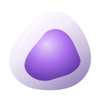
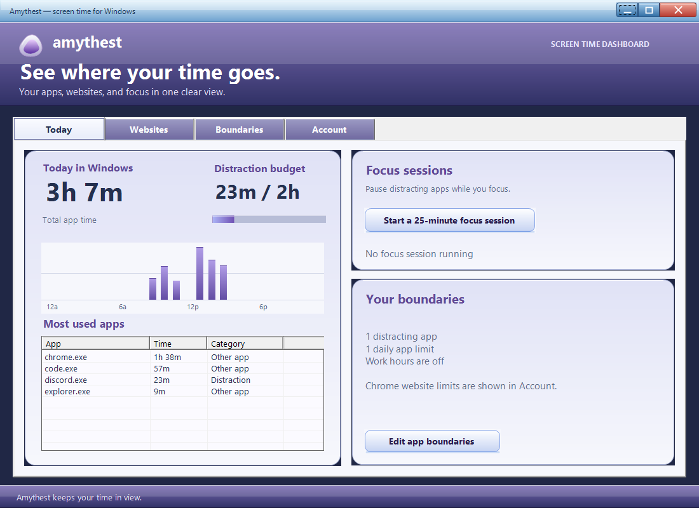

# amythest

Amythest helps you spend less time on distracting websites in Google Chrome. It shows your screen time, lets you start a focus session, and can block sites during work hours or after you reach a daily limit.

## Install it in Chrome

1. Download **[amythest-0.6.0-chrome.zip](https://github.com/soulflowxd/amythest/releases/download/v0.6.0/amythest-0.6.0-chrome.zip)** and extract it. Use the extracted folder, not the ZIP itself.
2. Open Chrome and go to `chrome://extensions`.
3. Turn on **Developer mode** in the top right.
4. Click **Load unpacked**.
5. Select the folder containing `manifest.json`. Do not select the ZIP file or `manifest.json` itself.
6. Click the puzzle-piece icon in Chrome and pin **amythest**.

This ZIP installs the Chrome extension. You do not need Iris, Git, Node, or a terminal for it. If you arrived from Publik, use the ZIP and steps above; Publik's generated guide does not describe the Chrome extension correctly.

After you change the extension's files, click **Reload** on its card at `chrome://extensions`.

The ZIP contains the Chrome extension. Download the Windows app separately if you want desktop program tracking.

## Windows companion

Amythest also has a separate Windows app for tracking time in desktop programs. Download the [Windows installer](https://github.com/soulflowxd/amythest/releases/download/v0.6.0/amythest-0.6.0-windows-setup.exe) for a Start menu shortcut and uninstall support, or download the [portable ZIP](https://github.com/soulflowxd/amythest/releases/download/v0.6.0/amythest-0.6.0-windows.zip), extract it, and open `Amythest.exe`. See [the Windows guide](windows/README.md) for connection steps. Keep the Chrome extension installed to manage individual websites and videos. The two apps store their totals separately on your device.

The Windows app follows [Amythest's design guide](DESIGN.md) and uses the same dashboard structure as the extension. Its **Websites** view can show Chrome's per-domain activity after you connect the extension using the steps in [the Windows guide](windows/README.md).

This is a screenshot of the built Windows app with sample data. It does not show anyone's browsing or app history.

## Use it

- **See your time:** Click the amythest icon to see today's time in Chrome. Open the dashboard for an iOS-style Screen Time view. **Day** shows time by hour; **Week** shows the last seven days and your daily average. All websites are tracked, including productive sites such as GitHub.
- **Focus session:** Pick 15, 25, 45, or 60 minutes in the dashboard, then start a session. Websites on your distraction list will be blocked until it ends.
- **Distraction list:** Add websites such as `youtube.com`. Subdomains such as `music.youtube.com` are included.
- **Work hours:** Turn this on in the dashboard and choose a start and end time. Your distraction list is blocked during those hours Monday through Friday. It uses your computer's local time. Work hours are off by default.
- **Daily site limits:** Enter a website and a number of minutes. Amythest adds up time on that site and its subdomains. Once the limit is reached, the site is blocked for the rest of the day. Limits reset at local midnight.
- **Take a break:** The reminder shown over a blocked website has a five-minute break button. It temporarily pauses focus, work-hour, and daily-limit blocks while keeping you on that website.
- **Distraction goal:** Set a daily goal for time on sites in your distraction list. Productive sites stay in the activity chart but do not move the goal bar unless you add them to that list. This goal is a progress guide; it does not block all websites.
- **Robot companion:** The robot starts cheerful, becomes neutral after one quarter of your daily distraction goal, and looks sad after three quarters. Time on YouTube long-form and short-form video pages counts even if their website is not on your distraction list. Video page time on a listed site is counted once. The expression resets with each new day; it is a gentle visual cue, not a judgment.
- **Check short-form videos:** Turn this on to pause YouTube Shorts, Instagram Reels, and TikTok's video feed. A specific Short, Reel, or TikTok video asks for a purpose and written reason; a valid response unlocks only that video for five minutes. Feed pages stay paused. Instagram's normal posts and messages, and TikTok messages, remain available. A separate switch hides Shorts shelves and sidebar links on YouTube. This applies even outside focus sessions.
- **Check long-form videos:** Turn this on to ask why you want to watch a YouTube video. The question appears over the video, so the tab keeps its YouTube address. Choose a purpose such as school or robotics and write what you need to do. A valid response unlocks that one video for 15 minutes. Switching to another video pauses playback and asks again. Amythest cannot verify whether the reason is true, so this is an intentional pause rather than an automatic judgment.

Written reasons for short-form and long-form videos are checked locally and are not saved. Only the chosen purpose and temporary access time stay in Chrome storage until access expires.

When the long-form check is on, it replaces whole-site focus blocking for `youtube.com` so the video question can appear. The short-form switch prevents default whole-site focus blocking for `instagram.com` and `tiktok.com`, allowing normal Instagram pages and TikTok messages to work. You can still set a separate daily site limit for either domain. Turn the long-form check off if you want your distraction list to block all of YouTube during focus sessions and work hours.

Reminders appear over the original website, so the tab does not change addresses. The same full-body Aero companion used in the popup appears angry on blocked pages. Inspired by the earlier interactive robot, it blinks at varied intervals, follows your cursor with its eyes and head, glances around when idle, reacts to clicks and keyboard activation, and lets you gently drag its head. Its body keeps the reference silhouette and does not grow on hover. It animates while a written reason is being checked. **Take a 5-minute break** temporarily clears site and video reminders, then the current rules resume automatically. Text fields keep keyboard shortcuts, including YouTube's spacebar shortcut, from interrupting typing. Amythest pauses ordinary page audio and video while a reminder is visible. The site still loads behind it; this is a self-control screen, not a network block.

## Optional account sync

Amythest's account backend uses **Convex**, like the [2026-scouting project](https://github.com/soulflowxd/2026-scouting), with email and password sign-in. There is no website to sign into: the extension dashboard contains the account controls. The separate Amythest development deployment is connected in `cloud-config.js`; no email delivery is needed for sign-in. See [account backend setup](convex/README.md), then reload the unpacked extension. Email addresses are not verified, and password recovery is not available yet. Never put an auth signing key in the extension or Windows app.

When you sign in, Amythest syncs daily totals by device, Chrome website limits, and Windows app limits. The extension account card can edit Windows app limits; the Windows Account view can edit Chrome website limits. Each type of limit applies only to its own platform. Saves check the latest version so a concurrent change is not silently replaced. The Windows app receives a short-lived sign-in token through its local Chrome bridge and syncs desktop totals and app boundaries separately. Website domain totals are synced; page URLs, titles, and typed reasons are not. Without an account, browsing totals and settings stay on your device and local tracking keeps working. Active website time is approximate and covers Chrome while it is focused.

The soft opal-shaped ring with an amethyst gradient center is the same mark in the toolbar and on extension pages. The mark has no dark tile behind it inside the interface. The interface uses Windows Segoe UI when available and bundles [Inter](https://github.com/rsms/inter) as an offline fallback under the SIL Open Font License. The interactive, full-body companion is original Amythest artwork inspired by the Aero style. An earlier avatar library remains in `vendor/agent-robot-avatar/` with its license, but the extension no longer loads it.

## License

Amythest's original code and artwork are available under the [MIT License](LICENSE). The bundled avatar and font retain their own licenses in `vendor/agent-robot-avatar/LICENSE` and `assets/fonts/OFL.txt`.
